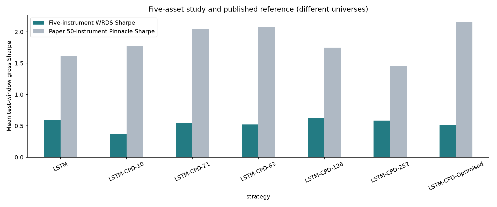

# Slow Momentum with Fast Reversion: five-asset study

Enze Hu and Jinrui Hu | IEOR 4576

This completed study applies the authors' LSTM and GPflow changepoint method to **SP (S&P 500), TY (US 10-year Treasury note), BN (British pound), ZG (gold) and ZU (crude oil)**. Thirty model/window searches and 1,500 candidate fits are complete.

Gross mean-window Sharpe is **0.589 for LSTM** and **0.518 for validation-selected CPD-LSTM**. The paper reports **1.62 and 2.16** on 50 Pinnacle instruments. The five-asset experiment does not recover the reported CPD improvement. Differences in universe size, data construction, dates, environment and random-search realization prevent an exact numerical comparison.

- [Executed final notebook](report/Paper67_Author_Five_Assets.ipynb): Run All displays committed results; training is off by default.
- [Results and interpretation](report/RESULTS.md)
- [Paper comparison](report/paper_reference_comparison.csv)
- [Execution manifest](report/execution_manifest.json) and [30-search inventory](report/tables/replication/experiment_inventory.csv)
- [1,500 candidate records](report/tables/replication/candidate_search_inventory.csv)
- [Protocol and implementation differences](docs/REPLICATION.md)

## View results

Install the project or a Python environment with pandas, matplotlib, PyYAML, nbformat and Jupyter. Open the final notebook and Run All. Viewing requires neither WRDS access nor model weights. To run a new experiment, explicitly set RUN_EXPERIMENT=True after preparing authorized data and the runtime described in docs/REPLICATION.md.

Core author source is pinned at e0352cb0bdbf8045accb1bf1a5705ae0cb9ea624. Compatibility and graph-reuse adaptations are recorded in src/momentum_lab/author_compat.py and author_cpd_runtime.py. The tested graph optimization preserves initialization and optimizer settings; it is not an unmodified historical binary environment.

## Layout

Research logic lives under src/momentum_lab/, ordered pipeline entry points under scripts/, and settings under configs/. The final notebook, written analysis, aggregate tables and figures are under report/. notebooks/ is for exploration; resources/ holds the hierarchy and references. Licensed observations, weights, credentials and local runtime settings are excluded from Git.

[Hierarchy](resources/repo_hierarchy.txt) | [Data decisions](docs/DATA_DECISIONS.md) | [Completion status](docs/STATUS.md) | [References](resources/REFERENCES.md)

