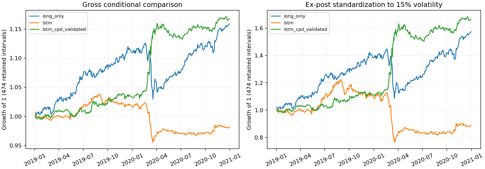
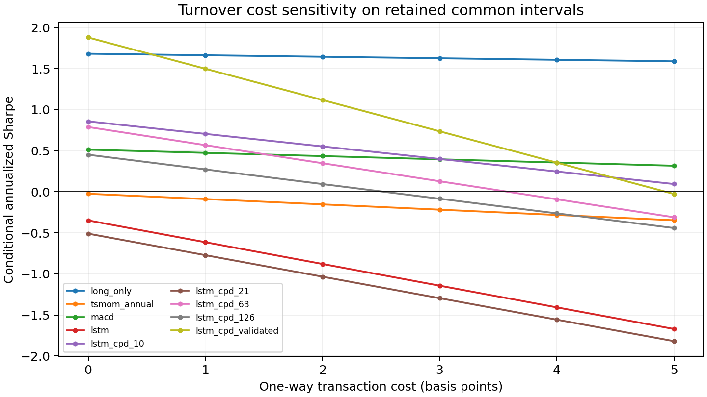

# Slow Momentum with Fast Reversion on a WRDS Futures Panel

**Group 67 — Enze Hu (eh3203), Jinrui Hu (jh5260)**  
**Completed replication results, November 2, 2026**

**Executive finding.** In the 24-market, fixed-split adaptation, validation-selected
CPD improves gross Sharpe from -0.3484 to 1.8803, but falls below long only after
1 bp one-way modeled costs. Enze's complementary five-asset, expanding-window
study reports 0.5889 for ordinary LSTM and 0.5182 for selected CPD. Together these
results strengthen the motivation to study how market composition, diversification
and pooled learning affect CPD's relative performance. They do not establish that
adding markets causes Sharpe to rise or makes CPD the best strategy more often.

## 1. Research question and scope

Wood, Roberts and Zohren (2022) augment a deep momentum LSTM with Gaussian-process
changepoint severity and location. We investigate whether those additional
features improve a momentum strategy on an alternative WRDS futures panel.
Our comparison includes long only, annual and monthly time-series momentum,
their equal blend, MACD, the ordinary author LSTM, and five CPD-LSTM variants.

This is a partial method replication. The original paper uses 50 Pinnacle
continuous futures, observations from 1990-2020, expanding five-year evaluation
windows and a within-asset 90/10 training/validation split. We use 24 provisional
distinct underlying markets from WRDS Datastream, train through 2016, validate
in 2017-2018 and compare performance in 2019-2020. We do not claim matching
original-paper numerical results, a full-calendar tradable backtest, or universal
CPD superiority. The project developed through exploratory pilots and is not
preregistered. Observations from 2021-2025 remain reserved.

We also incorporate the completed five-asset author-source study committed by
Enze Hu on branch `Enze-5-assets-reproduction`, commit
`f88874663ba3641f06c867c45446b1c4e5faf93e`. Its long-history comparison is
complementary evidence, not an additional fold of the 24-market experiment.
The original five-asset implementation remains available at that pinned commit;
this package includes its aggregate evidence and a reproducible comparison of
the committed tables. It does not claim to reproduce that study's private
individual-contract data or fitted weights independently.

## 2. Data and preparation

The source is WRDS LSEG Datastream Futures Continuous Series Data. A 50-series
query produced 1,389,945 expanded records, corresponding to 244,960 distinct
series/date keys. Repeated keys had identical core prices and relevant metadata;
they were collapsed before selecting the coverage-qualified panel. Having multiple
contract maturities or duplicated session variants does not create independent
underlying assets. The selected codes and provisional market identities are:

| Code | Market | Code | Market |
|---|---|---|---|
| 2338 | CAC 40 | 2374 | Sugar No. 11 |
| 2433 | US Treasury bond | 3801 | Full-size S&P 500 index |
| 4122 | Euro Bobl | 4199 | Euro Bund |
| 6409 | US Dollar Index | 6682 | US 5-year Treasury note |
| 8634 | Cocoa | 9017 | US 10-year Treasury note |
| 9020 | FTSE 100 | 9603 | STOXX Europe 50 |
| 9896 | Coffee C | 10272 | Orange juice |
| 11284 | Lumber | 12290 | EURO STOXX 50 |
| 21630 | Euro FX | 22726 | British pound |
| 22970 | Class III milk | 22990 | Japanese yen |
| 23134 | Lean hogs | 23151 | Live cattle |
| 23163 | Feeder cattle | 23253 | Mexican peso |

These are provisional underlying matches, not verified exact equivalents of all
paper contracts. In particular, code 3801 is not identified as the E-mini S&P 500.
Settlement/index values are available, but OHLC, volume and open interest are
unpopulated. The continuous-series roll metadata describe a price index and
do not establish Pinnacle ratio-adjustment equivalence or a complete executable
contract-roll strategy.

The universe was selected using data coverage through the comparison period.
This can introduce availability/survivorship selection and is not an ex-ante
tradable universe construction.

The immutable selected input snapshot preserves raw price levels. The following
explicit preparation policies are applied before feature construction:

- Sugar dates are restricted to dates also observed in both cocoa and coffee.
  This conservative shared-market restriction is not a fully verified historical
  exchange calendar.
- Sugar/cocoa/coffee observations on the documented January 3, 2011 special
  suspension are excluded. Feeder cattle's April 6, 2012 anomalous observation
  is excluded following settlement-calendar review.
- The Mexican peso scale break on January 13, 2017 starts a new independent
  segment. No assumed tenfold price correction is applied.
- Gaps exceeding seven calendar days start independent segments; sequences
  and GP windows cannot cross a break. A remaining raw adjacent index move
  above 30% stops preparation for review rather than being automatically clipped.
- There is a common 253-observation warm-up so every model can use the full
  CPD lookback set. Derived author features retain the author's causal EWM
  winsorization; this does not overwrite source price levels.

There are 87 recorded preparation actions, 37 raw history segments and 55,839
usable feature rows. Ninety-two cutoff/prefix checks confirm that extending the
input beyond each cutoff does not change the already-computed features/targets
on their common observed prefix. Labels crossing training/validation/test
boundaries are excluded from fitting.

The test comparison retains **474 identical signal/return intervals with all
24 assets available**: 11,376 asset observations. The saved inference covers
12,162 available per-asset test endpoints before this common-interval filter.
Unmatched market dates are omitted rather than manufactured or forward filled.
Consequently the reported annualized statistics are conditional on those retained
intervals, using a 252-observation annualization convention. They are not the
literal two-calendar-year CAGR or a full daily self-financing portfolio record.

## 3. Model and selection procedure

We use the author's executable eight-feature implementation: normalized returns
over 1/21/63/126/252 observations and MACD pairs (8,24), (16,48), (32,96).
This follows the released code where isolated literal numbers in the paper's
input-feature prose differ. An LSTM with a time-distributed tanh output generates
positions bounded by -1 and 1. Sequence length is **63** for both ordinary and
CPD models. A CPD lookback of **252** is a separate GP-history choice; it does
not change the LSTM sequence length to 252.

Each CPD variant adds two features, severity and normalized relative location,
for one lookback in {10,21,63,126,252}. GPs are fitted on standardized raw-index
returns within each independent history. Every window independently initializes
the original author's Matérn and changepoint fitting function, with an iteration
cap of 200. A failed fit uses only the latest successful result in the same
segment, advancing its relative location by the elapsed observations.
The saved author-code location feature is relative age, `(current index -
changepoint index) / lookback`. This is the reverse orientation of the location
written in the paper's Eq.10; we preserve the executable author convention
consistently rather than change fitted inputs after observing results.

The network optimizes the author's Sharpe loss using Adam. Training and
validation use the author's nonoverlapping padded batches, with sliding
63-observation inference at test time. There are 523 training sequences and
196 validation sequences, representing 31,809 and 11,844 active labels.
Validation aggregates available contributions using fixed N=24, with unavailable
assets unallocated. Test returns also use fixed N=24 on retained complete intervals.

Fifty matched hyperparameter candidates are drawn per variant from the author's
grid: hidden sizes 5/10/20/40/80/160, dropout 0.1-0.5, learning rates
0.0001/0.001/0.01/0.1, gradient clipping 0.01/1/100 and batches 64/128/256.
Maximum epochs are 300, early-stopping patience is 25, and the validation
improvement threshold is 1e-4. The search seed is 67; trial seeds are
67 + 1009 times the trial number. This gives 50 ordinary-LSTM fits and 250
CPD-LSTM fits. The overall CPD method therefore has an additional structural
window search relative to the ordinary model; the comparison is not a controlled
causal attribution of improvement solely to extra features.

| CPD lookback | Validation-selected trial | Validation Sharpe | Best epoch | Updates at checkpoint |
|---|---:|---:|---:|---:|
| 10 | 21 | 1.4610 | 21 | 105 |
| 21 | 44 | 1.4963 | 36 | 108 |
| 63 | 38 | 1.7368 | 1 | 5 |
| 126 | 21 | 1.7430 | 33 | 165 |
| **252** | **22** | **1.8031** | **92** | **460** |

The **252** variant is selected by validation before the supplementary
fixed-lookback test table is examined. Its settings are hidden size 40,
dropout 0.2, clipping 1, learning rate 0.1 and batch size 128. Its trial stopped
at epoch 117, preserving epoch 92. The ordinary LSTM selects trial 8, hidden
size 80, dropout 0.1, clipping 1, learning rate 0.01, batch size 128 and epoch 22.
The best 63-day checkpoint occurs after only one epoch; that is a consequence
of validation selection, not evidence that its generalization is reliable.

## 4. Gross comparison

Asset contributions use the author's 15% annual asset volatility target before
equal weighting. This does not imply a 15% portfolio volatility. Raw-index
diagnostics are also saved. The following table uses the primary author targets.

| Strategy | Conditional annual return | Annual volatility | Sharpe | Max drawdown |
|---|---:|---:|---:|---:|
| Long only | 8.1679% | 4.7346% | 1.6823 | 8.5421% |
| Annual TSMOM | -0.2096% | 4.5254% | -0.0238 | 6.1508% |
| Annual/monthly blend | 1.5875% | 4.1281% | 0.4021 | 4.7556% |
| Monthly TSMOM | 3.3195% | 5.7051% | 0.6008 | 5.5699% |
| MACD | 1.5901% | 3.1667% | 0.5140 | 3.5959% |
| Ordinary LSTM | -0.9713% | 2.6970% | -0.3484 | 7.9485% |
| LSTM + CPD 10 | 2.9227% | 3.4246% | 0.8583 | 2.5018% |
| LSTM + CPD 21 | -1.2778% | 2.4628% | -0.5099 | 7.1873% |
| LSTM + CPD 63 | 2.9537% | 3.7778% | 0.7894 | 2.9009% |
| LSTM + CPD 126 | 1.6199% | 3.7069% | 0.4520 | 4.0589% |
| **LSTM + CPD 252 / validation-selected** | **8.5740%** | **4.4274%** | **1.8803** | **2.3843%** |

The chosen CPD variant improves the gross risk-adjusted result relative to the
ordinary LSTM and long only in this run. It is not a constant-long solution:
mean position is 0.2135, mean absolute position is 0.6320 and 65.68% of positions
are positive. The negative 21-day result shows that adding CPD does not help
uniformly across lookbacks. Unlike the original paper's aggregate result,
the longest window is selected here; differences in data, split, universe and
sampling prevent a direct numerical comparison. No confidence interval or
multi-seed test establishes statistical superiority.

## 5. Equal-risk presentation

Following the paper's comparison at a common risk scale, each gross portfolio
series is multiplied by a single full-common-test constant:

`multiplier = 0.15 / (sample standard deviation of retained returns * sqrt(252))`.

This is **ex-post standardization**, not a causal leverage strategy. Annualized
returns and drawdowns are recomputed after scaling; Sharpe is unchanged.

| Strategy | Conditional annual return at 15% vol. | Sharpe | Max drawdown |
|---|---:|---:|---:|
| Long only | 27.2401% | 1.6823 | 24.9967% |
| Ordinary LSTM | -6.1634% | -0.3484 | 37.5549% |
| Selected LSTM + CPD | 31.1117% | 1.8803 | 7.9318% |

All rows have 15% realized sample annualized volatility on the same retained
intervals. This standardized return is not an independently observed tradable
annual profit forecast.

## 6. Transaction-cost sensitivity

We apply the paper's Eq.15 using absolute changes in volatility-scaled exposure:

`exposure = position * 0.15 / (daily_vol * sqrt(252))`  
`net return = gross return - cost_bps * 1e-4 * abs(change in exposure)`.

Turnover is computed from all available per-segment test endpoints **before**
filtering onto the 474 common intervals. Thus a reversal on a date omitted
from the common comparison still changes the immediately preceding position
used for turnover at the next retained observation. First available entry
turnover is zero, matching the author's implementation; final liquidation is
not charged. Costs are applied to original strategy exposure, not the ex-post
15% standardized series.

| Strategy | Sharpe, 0 bps | Sharpe, 1 bp | Sharpe, 2 bps | Sharpe, 5 bps |
|---|---:|---:|---:|---:|
| Long only | 1.6823 | 1.6638 | 1.6453 | 1.5898 |
| Ordinary LSTM | -0.3484 | -0.6140 | -0.8792 | -1.6716 |
| CPD 10 | 0.8583 | 0.7056 | 0.5529 | 0.0948 |
| CPD 21 | -0.5099 | -0.7720 | -1.0341 | -1.8195 |
| CPD 63 | 0.7894 | 0.5687 | 0.3484 | -0.3103 |
| CPD 126 | 0.4520 | 0.2731 | 0.0942 | -0.4415 |
| **Selected CPD 252** | **1.8803** | **1.4995** | **1.1183** | **-0.0264** |

The selected model's gross advantage over long only disappears at approximately
**0.547 bps one-way**, within this fixed conditional calculation. Its Sharpe
crosses zero at approximately 4.931 bps. These are scenario crossover points,
not measured market execution costs or universal thresholds. The strongest
supported practical finding is substantial turnover sensitivity.

Unmatched dates remain omitted from performance statistics. Costs charged on
retained dates do not account for the entire full-calendar portfolio experience.
Continuous-index data do not reconstruct all roll trades, discrete contract
sizes, bid-ask spreads, funding, margin constraints or exchange-specific fees.
The scenarios therefore do not establish executable net performance.

## 7. Verification and reproducibility

All 300 ordinary/CPD trial records are complete and their selected checkpoints
agree with validation histories, patience rules and optimizer update counts.
The CPD family accounts for 15,582 training epochs. Canonical model/optimizer
arrays match the selected checkpoint; original ordinary-LSTM files are preserved.

The full GP computation covers 279,195 windows. There are 154 failed fits
(0.0552%): 94/44/10/6/0 for lookbacks 10/21/63/126/252. Every fallback uses the
latest past successful fit in the same history, with correctly advanced location.
Independent numerical likelihood reconstruction on 465 stored-parameter samples
reproduces CPD scores with maximum absolute error 2.7e-10, without refitting GPs.
This validates sampled parameter/data consistency, not global optimization.

Uploaded GPU checkpoint replay positions agree with the earlier saved ordinary
and selected CPD outputs to about 3e-8. Independent recomputation of all gross,
standardized and cost metrics agrees within 1.2e-13; net-return arithmetic within
2e-16. No fresh GPU optimization was performed during the independent audit.

`python run_all.py --bundle-dir <private-archive-directory>` rebuilds tables,
figures and audit results without TensorFlow inference or retraining. The
optional `--stage full` preserves the original scientific scripts and their
hashes in an isolated runtime for fresh estimation. README.md, DATA_ACCESS.md,
THIRD_PARTY.md and VALIDATION.json distinguish verified reporting from the
expensive estimation wrapper that was not rerun during packaging.

## 8. Differences from the original paper

The following register distinguishes known adaptations, paper/code convention
differences, unreplicated analyses and details whose equivalence has not been
established. An unverified detail is not treated as a proven methodological
match or a proven error in the original study.

| Dimension | Original paper or released author implementation | This replication and implication |
|---|---|---|
| Data vendor | Pinnacle CLC continuous futures. | WRDS LSEG Datastream continuous price-index series. Matching a model does not make the return construction equivalent. |
| Number and identity of markets | 50 futures spanning commodities, equities, fixed income and FX, with contract/session distinctions in the paper's list. | 24 provisional distinct underlying markets. Exact Pinnacle-contract equivalence is not verified; this is not a confirmed literal subset of 24 of the original 50. |
| Asset mix | The paper includes markets unavailable in our downloaded candidate catalog. | Several energy/metal and other markets are absent; sector composition and correlations change alongside market count. Missing series are not explained by an established licensing cause. |
| Universe eligibility | Assets enter a test window when sufficient validation history is available; the paper describes less than 10% missing data for selected assets. | Eligibility uses 2017-2018 and 2019-2020 coverage. This can introduce availability/survivorship selection; no equivalent less-than-10%-missing guarantee is claimed. |
| Historical span | 1990-2020, subject to market availability. | Features use 2010-2020. The raw snapshot also contains later observations, but 2021-2025 are excluded and reserved. |
| Training/validation split | Chronological 90/10 within each asset's expanding estimation history. | Fixed training through 2016 and validation in 2017-2018, after warm-up and segment availability. |
| Out-of-sample design | Expanding estimation history and successive five-year test windows, with retuning at each expansion. | One 2019-2020 comparison. No five-year expansion or retuning sequence has been reproduced. |
| Reported aggregation | Main results are averages of the five-year test-window statistics. | Statistics are calculated over one retained interval sequence, rather than averages of the paper's windows. Their numerical levels are not directly comparable. |
| Calendar and observation coverage | Daily strategy backtests across the paper's evaluation windows. Exact asynchronous-calendar handling is not fully established from the text. | Only 474 identical complete intervals are retained. Omitted dates are not repaired; this is a conditional comparison rather than a complete executable daily portfolio. |
| Source-specific cleaning | The paper describes causal EWM winsorization; it does not specify the WRDS anomalies encountered here. | Additional shared-ICE-session restriction, specified closure/settlement exclusions, Mexican-peso break and gap resets, plus a review stop for unexplained moves above 30%. These are documented adaptation choices. |
| Warm-up and history breaks | Sequence availability and original feature construction govern usable observations; an identical universal 253-observation rule is not established in the paper text. | All variants share a 253-observation warm-up. No sequence or GP fit crosses a declared independent segment. This sacrifices some shorter-window observations. |
| Portfolio denominator | Eq.11 averages contributions over N assets; the eligible universe can differ across expanding windows. | Fixed N=24 on union validation dates, unavailable contributions unallocated; fixed N=24 on balanced common test intervals. Precise equivalence of missing-asset treatment is not claimed. |
| Input-return/MACD conventions | The paper's input prose prints a 256-observation annual offset and MACD (16,28); the released executable code uses 252 and (16,48). | We follow the released code: 1/21/63/126/252 and (8,24)/(16,48)/(32,96), rather than silently substitute the prose numbers. |
| CPD location convention | Eq.10 describes location increasing from the window's start; the author function returns normalized age from the current observation. | We preserve the executable author feature `(t-c)/lookback`. This is the opposite orientation of the written location formula, and the trained inputs are not changed after evaluation. |
| Search controller and stochastic realization | The paper specifies random-grid search and the author repository contains the historical tuner machinery. | A resumable controller uses matched candidates across variants and search seed 67. Exact original sampled candidates/seeds are not reproduced. Final budget remains 50 trials per variant, not the earlier reduced pilot budget. |
| Repeated-experiment evidence | Section IV-C additionally reports five repeated experiments for the 2015-2020, 21-day-CPD comparison. | One search-seed experiment is reported. We have not reproduced that five-repeat robustness analysis or established confidence intervals. |
| Software/runtime | Author Keras/TensorFlow and GPflow implementation. Exact historical hardware/runtime equivalence is not established. | Python 3.10, TensorFlow/tf-keras 2.21 and GPflow 2.2.1 in WSL, RTX 5070; two explicit API/dtype compatibility edits. Bitwise equivalence to historical execution is not claimed. |
| GP execution and fallback diagnostics | Independent per-window author GP fitting; the paper describes fallback to earlier outputs after fitting failure. | The original fitting function and 200-iteration cap are retained, with streaming dispatch and worker recycling for memory. All 154 past-only fills are audited; runtime engineering is changed, not presented as a new GP model. |
| Portfolio 15% presentation | The paper reports an additional common-risk comparison alongside raw signals. | We apply one ex-post full-common-test multiplier per strategy and recompute metrics. It is not causal risk targeting; exact historical scaling code/window equivalence is not established. |
| Transaction-cost analysis | Appendix C studies 0-5 bps and averages across its five-year windows. | The same exposure-change formula is applied to our conditional 2019-2020 comparison, computing turnover before the common-date filter. First entry and terminal liquidation charges are omitted; complete roll/contract execution is unavailable. |
| Economic result | The paper reports broad gross CPD improvements and favorable smaller/intermediate lookbacks, including its validation-optimized strategy. | Validation selects 252 here; the 21-day model loses money. The selected gross winner falls below long only at 1 bp. We do not reproduce the paper's exact rankings, Sharpe levels or cost threshold. |
| Other original exhibits | The original study includes long-history window comparisons and market/regime case analyses. | We provide gross, standardized and cost comparisons, but have not recreated every original exhibit, historical GP illustration or crisis/Brexit case study. |
| Development and extension scope | The paper is a separate completed study ending in 2020. | Our work developed through observed pilots. No preregistration is claimed, and no reserved-2021-2025 extension result or causal market-count experiment has yet been produced. |

Several central choices are deliberately retained: the author LSTM and Sharpe
loss, a 63-observation LSTM sequence, the five CPD lookbacks, the published
hyperparameter grid, 50 trials per variant, a 300-epoch cap and patience 25,
nonoverlapping training/validation batching, the 15% **asset** risk target,
and validation-only checkpoint/window selection. These retained choices should
not be described as differences. LSTM sequence length 63 and GP lookback 252
refer to different parts of the model and are compatible with the paper.

## 9. Exploratory observation: does a larger universe favor CPD?

Our development runs motivate the hypothesis that a larger, diversified market
universe **may** improve the absolute Sharpe ratio of LSTM + CPD, its advantage
over ordinary LSTM, or the frequency with which it ranks first among strategy
benchmarks. These are three distinct outcomes; none has been established as a
monotonic or causal function of market count.

| Study | Markets | Test scope and aggregation | Ordinary LSTM Sharpe | Selected CPD Sharpe | CPD minus LSTM |
|---|---:|---|---:|---:|---:|
| Earlier WRDS pilot | 1 | One 2019-2020 sequence; 505 observations | 1.1205 | 1.0469 | -0.0737 |
| Enze author-source study | 5 | 1995-2020; mean of five test-window Sharpes | 0.5889 | 0.5182 | -0.0707 |
| Current WRDS panel | 24 | 2019-2020; 474 retained common intervals | -0.3484 | 1.8803 | 2.2287 |

**These rows provide cross-study context, not matched estimates of a market-count
effect.** In particular, an average of window Sharpes is not the Sharpe of a
pooled return series, nor is it directly comparable to a single short test period.

### 9.1 What the five-asset result adds

Enze's study uses S&P 500 day-session futures (SP), 10-year Treasury-note futures
(TY), British-pound futures (BN), gold (ZG) and crude oil (ZU). It follows five
expanding test windows starting in 1995, 2000, 2005, 2010 and 2015, with a
chronological within-instrument 90/10 training/validation split. The final fold
includes 2015-2020; the first four folds each span five calendar years. It reports
30 model/window searches and 1,500 candidate fits, using 50 candidates per search.

| Five-asset strategy | Mean test-window Sharpe |
|---|---:|
| Long only | 0.7679 |
| MACD | 0.6492 |
| Ordinary LSTM | 0.5889 |
| Validation-selected CPD | 0.5182 |
| Fixed 126-day CPD | 0.6292 |

The selected CPD lookbacks are 63, 63, 126, 126 and 21 across the five folds.
Selected CPD exceeds ordinary LSTM in three folds, but its mean Sharpe is lower
because the losses in the other folds are larger. Fixed 126-day CPD modestly
exceeds ordinary LSTM on average; it cannot replace the validation-selected
result after inspecting the test set. Neither neural strategy beats long only
on the five-asset mean-window comparison. This is evidence of heterogeneous
CPD performance, not confirmation of universal CPD improvement.

Its data construction also differs from the 24-market study. Enze compounds
same-held-contract returns from WRDS individual-contract histories with explicit
roll timing. The 24-market study uses vendor continuous price indices. Gold and
crude oil are not in the 24-market pool, so this is not a nested five-market
subset that was simply expanded to 24. The environment, search realization,
training periods and portfolio/calendar treatment differ as well.

The five-asset means, fold selection and protocol were checked against the
committed evidence at the pinned GitHub revision. Original quotes, positions and
weights were not available for an independent five-asset raw-return replay.
Copies and provenance are in `report/evidence/enze_five_assets/`; the report
pipeline verifies fold averages and exports `cross_study_context.csv` and
`five_asset_fold_comparison.csv` without refitting models.

### 9.2 Interpretation of the market-count hypothesis

The pilot values come from `paper67_cpd_full_results.zip`, specifically
`cpd_lstm/comparison_2019_2020.csv`, rather than a preliminary smaller-budget
CPD run. Its source is WRDS code 1825, whose instrument/roll identity remains
unverified. It is not a matched one-market subset experiment drawn from the
final 24-market panel. Pilot result provenance is saved in
`report/evidence/pilot_panel_observation.json`.

The single- and five-market studies do not show a validation-selected CPD
advantage over ordinary LSTM, while the 24-market study does. This additional
contrast strengthens the **research motivation** for examining when CPD helps,
including a possible role for a broader market universe. It does not strengthen
the evidence enough to infer a causal size effect or a higher general probability
of being best. Absolute CPD Sharpe does not even rise monotonically across these
three reported rows: 1.0469, 0.5182 and 1.8803.

Changing N also changed market composition, source-series identity, data preparation,
the evaluation calendar, sampled hyperparameters, selected CPD lookback, training
pool size and optimization trajectory. The selected pilot CPD checkpoint used
25 training sequences and one batch per epoch; the panel used 523 sequences and
five batches per epoch. Part of the larger CPD-minus-LSTM difference also comes
from the ordinary model's deterioration. Neither result isolates asset count.
The original paper's 50-market result cannot be added as a third controlled
size experiment because its source, periods and evaluation design differ.

There are two plausible mechanisms worth separating. Pooling more histories
could help a shared network learn regime behavior. Separately, combining
imperfectly correlated strategy returns could lower portfolio risk. Under a
stylized equal-volatility, equal-correlation model,
`Var(R_portfolio) = sigma^2 * [1 + (N-1)*rho] / N`; this can reduce risk when
correlations are below one. It does not guarantee higher Sharpe when expected
returns, correlations, signal quality and costs also change. Highly correlated
or weak-signal additions can provide little benefit or worsen performance.
Ordinary LSTM and classical benchmarks can also benefit from diversification,
so a rise in CPD's absolute Sharpe would not by itself prove a relative advantage.
The working hypothesis is therefore conditional: a broader, sufficiently diverse
and consistently constructed universe **may** improve CPD's Sharpe and relative
ranking through diversification and more informative pooled training. Testing
those mechanisms requires the controlled design below.

In this report, "best" means the highest observed Sharpe among the declared
strategy benchmarks for a given equal-weight panel. We did not optimize asset
weights or search all asset combinations, so this is not a claim of an optimal
asset allocation. The current selected CPD model ranks first **gross**, while
long only outranks it at 1 bp; costs must remain part of that definition.

## 10. Proposed follow-up research — not yet performed

1. **Fix the data and comparison calendar.** Use verified independent underlying
   markets, consistent continuous-return/roll definitions, a common sample and
   the same preprocessing. Predeclare choices using training/validation. A formal
   extension should preserve truly held-out data; 2021-2025 have not yet been
   evaluated and should not be repeatedly inspected while choosing the design.
2. **Vary size and composition separately.** Within the same 24-market pool,
   study N in {1,4,8,12,18,24}, with multiple randomly drawn, sector-balanced
   subsets at each size. For N=24 there is only one distinct full subset, so
   repeated subset draws do not create new independent portfolios. Expansion
   beyond 24 requires additional verified markets, not duplicate contracts.
3. **Separate diversification from learning.** First aggregate frozen full-panel
   predictions over different subsets to examine diversification conditional on
   the same trained model; this is not an independent smaller-universe training
   experiment. Then retrain ordinary and CPD models within each subset to test
   pooled-learning effects. The frozen-model analysis remains descriptive unless
   carried out under a separately held-out protocol.
4. **Control search and optimization.** Reuse matched candidate grids and multiple
   seeds, keep all checkpoint/lookback selection on validation, and report equal
   per-variant search budgets. Because larger panels create more batches per
   epoch, add a matched-gradient-update comparison rather than confound market
   count with extra optimizer updates. Also examine comparable compute budgets.
5. **Measure absolute, relative and ranking outcomes.** Report gross and net
   Sharpe, CPD-minus-LSTM Sharpe, drawdown, turnover and the empirical fraction
   of predeclared subset/seed/window experiments in which validation-selected
   CPD beats **all** benchmarks. This win frequency is an empirical statistic,
   not an established universal probability. Include 0/1/2/5-bp scenarios and
   equal-risk comparisons without selecting a new winner from the test set.
6. **Quantify uncertainty and failure cases.** Use repeated seeds, independent
   test windows and paired time-block resampling that preserves cross-asset
   dependence. Report distributions and uncertainty for both Sharpe and its
   differences; avoid treating correlated subset draws as independent evidence.
   Examine whether gains depend on particular sectors, crises or high turnover.

These steps are a proposed research agenda, not completed results. The present
evidence supports a gross improvement in one 24-market experiment and a
testable universe-size hypothesis. It does **not** establish that adding markets
necessarily raises CPD Sharpe or makes it the best strategy more often.

## References

Wood, K., Roberts, S., and Zohren, S. (2022). *Slow Momentum with Fast Reversion:
A Trading Strategy Using Deep Learning and Changepoint Detection*.
arXiv:2105.13727v3. https://arxiv.org/abs/2105.13727.

Author code: https://github.com/kieranjwood/trading-momentum-transformer,
inspected commit `e0352cb0bdbf8045accb1bf1a5705ae0cb9ea624`.

Calendar/settlement checks used in preparation:

- https://www.ice.com/publicdocs/futures_us/exchange_notices/ExNot2012Holidays.pdf
- https://www.ice.com/publicdocs/futures_us/exchange_notices/ExNot2018HolidayCal.pdf
- https://www.cmegroup.com/tools-information/lookups/advisories/clearing/Chadv12-140.html
- https://www.cftc.gov/sites/default/files/stellent/groups/public/%40rulesandproducts/documents/ifdocs/rul121310iceus006.pdf

Companion five-asset study, Enze Hu, pinned team repository revision:

- https://github.com/EnzeHu0120/ieor4576-slow-momentum-fast-reversion/commit/f88874663ba3641f06c867c45446b1c4e5faf93e
- `report/RESULTS.md`, `report/paper_reference_comparison.csv`,
  `report/tables/replication/exhibits_by_fold.csv`,
  `report/tables/replication/selected_cpd_windows.csv`, and `docs/REPLICATION.md`
  at that revision. Aggregate copies and source hashes accompany this submission.
